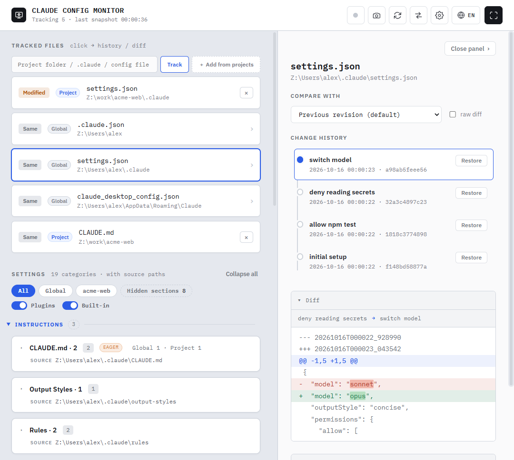
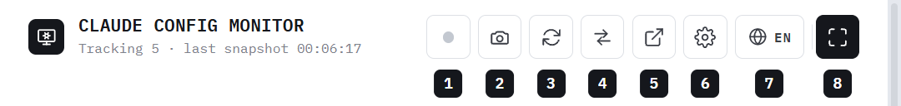
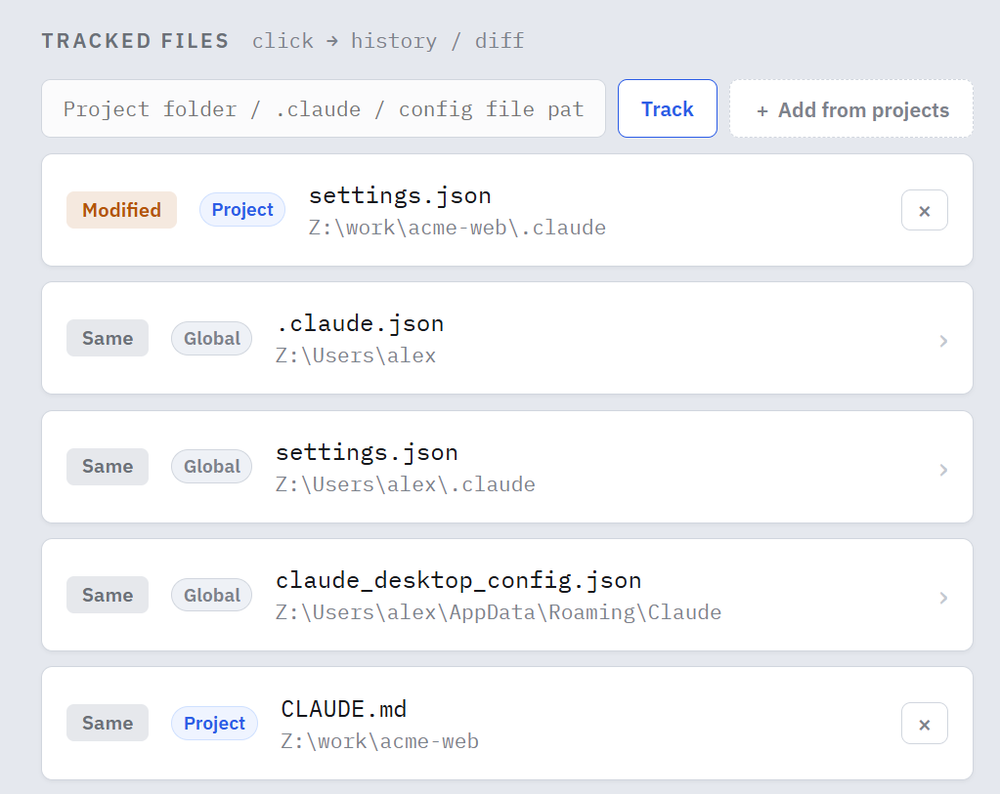
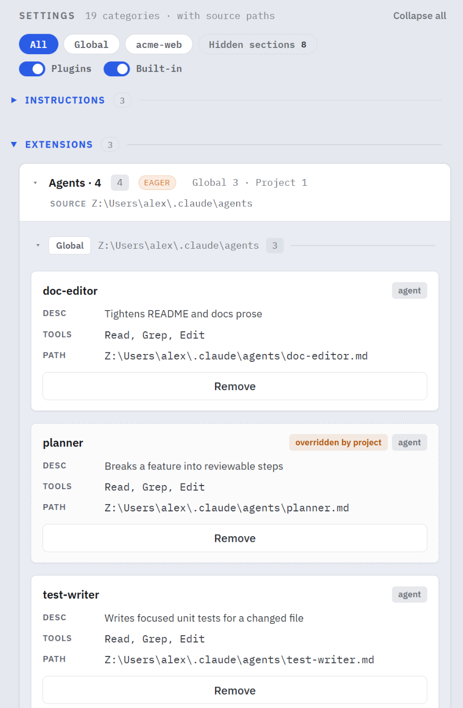
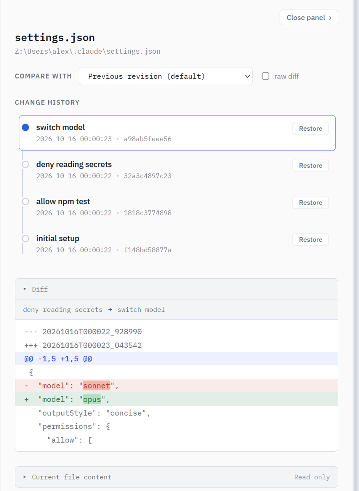
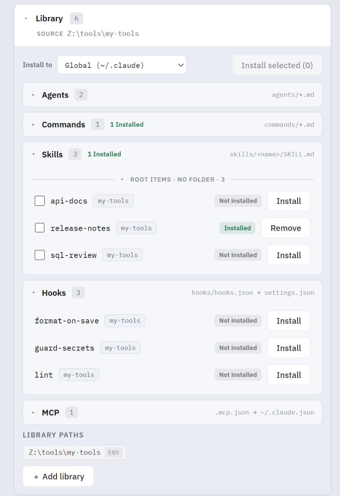
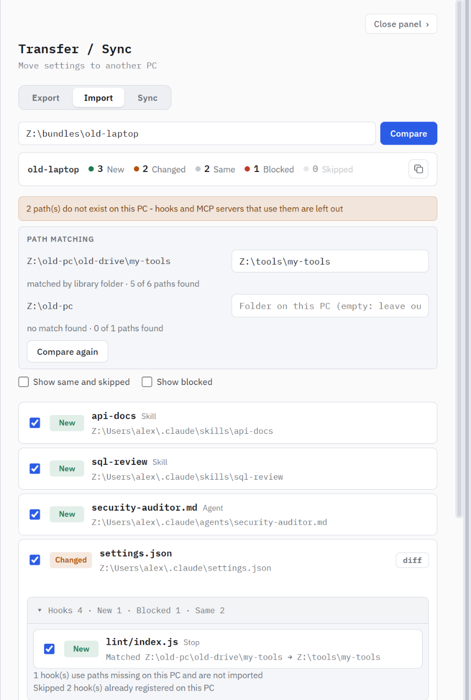

# Config Monitor

> See, edit, and roll back every Claude setting on your machine — from one dashboard inside Claude Desktop.



Skills, agents, hooks, MCP servers, permissions and `CLAUDE.md` live in different files for Claude Code, Claude Desktop and each project. **config-monitor** puts them on one screen, shows what is actually applied and where it comes from, and snapshots every change so you can undo it.

It is an [MCP App](https://modelcontextprotocol.io): the dashboard renders inside the Claude Desktop chat, and every action is also a normal MCP tool Claude can call for you.

## Features

- **One view** — Claude Code, Claude Desktop and every project, with `global` / `project` badges and the real precedence rules.
- **Context cost at a glance** — each section is marked `EAGER`, `LAZY` or `NEVER`, so you know what loads at session start.
- **Edit in place** — permissions, hooks, MCP servers, skills and agents, globally or per project.
- **Snapshots and diffs** — every change becomes a revision you can compare and restore.
- **Library and marketplaces** — install skills, agents, hooks and MCP servers from a folder, a git repo or a plugin marketplace.
- **Move to another PC** — export a bundle, import it elsewhere; paths are fitted to the new PC.
- **Safe by default** — nothing is deleted: overwrites keep a `.bak`, removals go to `.trash`.

## Quick start

You need **Windows**, **Claude Desktop**, **Node.js** (LTS) and **Python 3.10+** on `PATH`.

**1. Install**

```bash
git clone https://github.com/YeomYuJun/config-monitor-mcp-apps.git
cd config-monitor-mcp-apps
npm install
npm run build
```

**2. Register the server** — open Claude Desktop's `claude_desktop_config.json` (*Settings → Developer → Edit Config*) and add:

```json
"mcpServers": {
  "config-monitor": {
    "command": "npx",
    "args": ["tsx", "C:/path/to/config-monitor-mcp-apps/src/server-stdio.ts"],
    "env": { "CONFIG_MONITOR_LANG": "en" }
  }
}
```

**3. Restart Claude Desktop** and send **`Show config-monitor`**.

<details>
<summary>Optional settings (<code>env</code>)</summary>

| Variable | What it does |
|---|---|
| `CONFIG_MONITOR_LANG` | `en` starts in English; anything else starts in Korean. You can switch any time from the header. |
| `CLAUDE_SNAPSHOT_STORE` | Where snapshots are kept. Default `~/.claude-snapshot` (or `D:\.claude-snapshot` if it already exists). Keep it short. |
| `CLAUDE_CONFIG_LIBRARIES` | One or more library folders (`;`-separated) for the Library panel. |
| `CONFIG_MONITOR_WATCHER` | `auto` starts the file watcher with the server, so outside edits are snapshotted too. |

Microsoft Store installs keep the config under `%LOCALAPPDATA%\Packages\Claude_*\LocalCache\Roaming\Claude\`.
**git** is needed only for remote libraries, and the **`claude`** CLI only for installing whole plugins.

</details>

## Tour

### Header



1 **Watcher** — snapshot automatically when a file changes ·
2 **Snapshot** now ·
3 **Refresh** ·
4 **Transfer / Sync** ·
5 **Open in browser** ·
6 **Display settings** (sections, colors, snapshot cleanup) ·
7 **Language** ·
8 **Fullscreen**

### Tracked files



Files under snapshot watch. `~/.claude.json`, `~/.claude/settings.json` and the Desktop config are added automatically; **+ Add from projects** adds any project's `.claude`. Click a row to see its history.

### Settings



Every section as cards, grouped by purpose and filterable by scope. When two items share a name, the one that is **not** applied is flagged (`overridden by project`). Add or remove items right on the card. → [More on settings](USAGE.md#settings)

### History and diff



Each edit is one revision named after what it did. Click a revision to see what changed, compare with any other, or **Restore** — restoring is itself snapshotted, so it can be undone too. Noise such as usage counters in `~/.claude.json` is filtered out. → [More on history](USAGE.md#history-and-diff)

### Library



A library is any folder shaped like `.claude`. Install its skills, agents and commands into the global config or a project, and its tools as **hooks** or **MCP servers**. Items are compared by content, so you see `Installed`, `Modified` or `Conflict` at a glance.

Git repos and plugin marketplaces can be registered too. They are cached and pinned to a commit, and only update when you press refresh. → [More on the library](USAGE.md#library)

### Plugins

Claude Code plugins appear in their own section, and what they contribute is merged into the regular cards with a `plugin` badge. Browse a marketplace, check a plugin's contents and token cost before installing, then enable, disable, update or uninstall it. → [More on plugins](USAGE.md#plugins)

### Transfer and sync



**Export** writes your setup to a `.cmbundle` file (secrets are left out by default). **Import** compares it with this PC and shows each item as `New`, `Changed`, `Same` or `Blocked` before anything is written.

A bundle from another PC usually points at other drives and folders. Import matches them to this PC — by your library folder or the same folder on another drive — and you can correct the match. Anything that still points at a missing path is **left out** instead of breaking your setup, and a working server here is merged with the bundle rather than replaced. Paths it cannot match can be handed to Claude with one button. Every import can be undone.

**Sync** keeps several PCs aligned through a shared folder (OneDrive, Syncthing, a git checkout). → [More on transfer and sync](USAGE.md#transfer-and-sync)

## Ask Claude

Everything the dashboard does is an MCP tool, so you can just ask:

- *"Summarize my Claude setup."* → `summarize_config`
- *"Which hooks run on PostToolUse?"* → `get_config`
- *"Remove the `foo` skill from project bar."* → the same edit tools, with the same snapshots
- *"Import `D:\bundles\laptop.cmbundle` but keep my model setting."* → `config_import_plan` / `config_import_apply`

Changes made in chat show up in the open dashboard within a few seconds. → [More on asking Claude](USAGE.md#asking-claude)

## Safety

- Every edit, install, restore and import is snapshotted before and after.
- Overwritten files keep a `.bak`; removed items move to `.trash`.
- Untracking a file only stops watching it.
- Snapshot cleanup is two-step: the first click only shows what would go.

## What it covers

<details>
<summary>Files and sections</summary>

| Where | Becomes |
|---|---|
| `~/.claude.json` | Claude Code — global MCP servers and projects |
| `~/.claude/settings.json`, `settings.local.json` | Permissions, Hooks |
| `~/.claude/skills`, `agents`, `commands` | Skills, Agents, Commands |
| `~/.claude/rules`, `output-styles`, `workflows`, `themes` | Rules, Output Styles, Workflows, Themes |
| `~/.claude/CLAUDE.md`, project `CLAUDE.md` / `CLAUDE.local.md` | CLAUDE.md |
| `~/.claude/plugins` | Plugins |
| `~/.claude/agent-memory`, `projects/<project>/memory` | Agent Memory, Project Memory |
| `<project>/.claude/…`, `<project>/.mcp.json` | the same sections, as project items |
| Desktop `claude_desktop_config.json` | MCP Servers (desktop) |
| Desktop `skills-plugin/**/manifest.json` | Desktop Skills |
| `~/Claude/Scheduled/*/SKILL.md` | Scheduled Tasks |

Only the fields shown on cards are read. Conversation history in `~/.claude.json` is never read.

</details>

## Limits

- Windows only; macOS and Linux paths are not probed.
- Commands, themes, `CLAUDE.md` and a project's `.mcp.json` are view-only.
- New skills and agents are scaffolded globally; add them to a project from the Library.
- Remote libraries never update on their own.

## Development

```bash
npm run typecheck
python -m unittest discover -s tests
python scripts/demo_profile.py Z:\   # demo profile used for the screenshots
```

Precedence rules follow the official Claude Code docs and may shift between versions.
